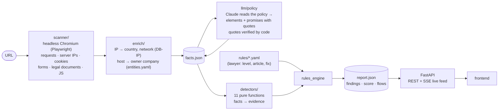

# Probo — what does a website really do with personal data?

> Product name Probo (D-022; the Python package is still called `qalqon`). LexHackathon 2026, track 1 "Huquqiy xizmatlarni ko'rsatish" (legal services).

Probo opens a website the way a normal visitor does, records where personal data actually goes — which servers,
which countries, which companies — reads the site's own privacy policy, and checks both against the law of
Uzbekistan (ZRU-547 "On personal data", incl. the 2026 version of art. 27¹ on localization).
The result is a report with **signs of violation** 🔴🟡⚪, each with evidence and the article of law, and a score 0–100.

**What makes it different:** lawyers read documents, scanners read traffic. Probo compares the two:
*"the policy says «data is not shared with third parties» — but Meta (US) and Google (US) receive visitor identifiers
on the first visit, before any consent."*

| | |
|---|---|
| Product, decisions, team tasks | [`PASSPORT.md`](PASSPORT.md) — single source of truth |
| Architecture, data contracts, build log | [`ARCHITECTURE.md`](ARCHITECTURE.md) |
| Research (legal, market, competitors) | [`research/`](research/) |

---

## Architecture



**Principles**

1. **Code collects facts, rules decide, the LLM only reads** (D-010). Whether something is a violation is decided by a
   deterministic detector + a YAML rule written by the lawyer — never by the model. The model only extracts promises
   from the policy, and every quote it returns is checked against the document text; unverifiable quotes are dropped.
2. **Collect once, evaluate many times** (D-015). A scan is saved as `facts.json`; rules and detectors re-run on it in
   about a second (`rescore`). When the lawyer edits a rule, reports update without re-crawling.
3. **Precision over recall** (D-019). We scan real companies, so a detector reports only what it can show with clear
   evidence. Every detector was checked against real-site evidence; four false or overstated findings were caught and
   fixed (a random ID read as a phone number, SMS-login forms read as consent violations, a policy's honest "in Uzbekistan
   and abroad" read as a contradiction, a promise quoted without its exceptions).
4. **Passive and safe by default** (D-009). We open public pages like any visitor: no logins, no form submissions,
   no vulnerability probing (that is the Cybersecurity Center's area, D-008). SSRF guard on the API.
5. **Bot protection never produces findings** (D-018). If the scanner lands on a captcha / Cloudflare challenge,
   those requests are marked and the site is reported as "closed to the check".

---

## Quick start

Requirements: Python 3.11+, ~400 MB disk for Chromium and the geo databases.

```bash
cd backend
python -m venv .venv
.venv/Scripts/python -m pip install -r requirements.txt        # Linux/macOS: .venv/bin/python
.venv/Scripts/python -m playwright install chromium            # Linux server: add --with-deps
.venv/Scripts/python -m qalqon.enrich.geo --download           # DB-IP Lite country + ASN databases (offline lookups)
cp ../.env.example ../.env                                      # then fill in ANTHROPIC_API_KEY
.venv/Scripts/python -m pytest                                  # 29 tests, no network needed
```

### Command line

```bash
# One site: crawl → enrich → LLM policy analysis → rules → report (≈1–2 min)
.venv/Scripts/python -m qalqon.scan https://example.uz --max-pages 10
.venv/Scripts/python -m qalqon.scan https://example.uz --events        # one JSON event per line (what the API streams)
.venv/Scripts/python -m qalqon.scan https://example.uz --no-llm        # skip the LLM step

# Many sites in parallel (one per sector for the demo)
.venv/Scripts/python -m qalqon.batch data/reference_sites.yaml --max-pages 6 --parallel 4

# Re-evaluate saved scans after a rule / detector change — no crawling, seconds
.venv/Scripts/python -m qalqon.rescore ../scans/batch-<stamp>
.venv/Scripts/python -m qalqon.rescore ../scans/batch-<stamp> --llm    # add the LLM analysis where missing (cached)
```

Outputs go to `scans/<scan_id>/` (git-ignored): `facts.json`, `report.json`, `scan.har` (evidence), `events.jsonl`.

### Web app (frontend)

```bash
cd frontend
npm install
npm run dev          # http://localhost:5173, proxies /api to the backend on :8000
npm run build && npx vite preview   # production build on http://localhost:4173
```

Screens: Home · Live scan (SSE) · Report (Overview, Findings, Data flows, Policy) · History. Uzbek (Latin) / Russian,
presentation mode hides site names and brand aliases. Design notes: `frontend/DESIGN.md`; product spec: `PRODUCT.md`.

### API

```bash
cd backend
.venv/Scripts/python -m uvicorn qalqon.api:app --port 8000

curl -X POST localhost:8000/api/scans -H "Content-Type: application/json" -d '{"url":"example.uz","max_pages":5}'
curl -N localhost:8000/api/scans/<scan_id>/events          # live feed (SSE)
curl "localhost:8000/api/scans/<scan_id>?anon=1&facts=1"   # report; anon=1 = presentation mode (no site names)
curl localhost:8000/api/stats                               # anonymized numbers across the latest batch
```

| Endpoint | Purpose |
|---|---|
| `POST /api/scans` | Start a scan (runs as a subprocess; max 2 in parallel; private/loopback targets refused) |
| `GET /api/scans/{id}/events` | SSE: `start`, `page`, `host` (country, network, owner), `challenge`, `form`, `document`, `policy`, `finding`, `done`, `end`. Finished scans are **replayed** — the demo works even if the venue network fails |
| `GET /api/scans/{id}` | Report (+ facts with `facts=1`; anonymized with `anon=1`) |
| `GET /api/scans` | Finished scans with sector labels and scores |
| `GET /api/scans/{id}/har` | Evidence file (all network requests) |
| `GET /api/stats` | Anonymized aggregate for the pitch |

Event payloads are documented in `ARCHITECTURE.md` (API section).

### Deployment (Docker)

One container serves the API and the built web app on one port (`Dockerfile`, `docker-compose.yml`):

```bash
cp .env.example .env            # fill in the keys
docker compose up -d --build    # builds the web app, installs Chromium, downloads the geo databases
docker compose logs -f probo
```

- The container listens on `127.0.0.1:8090` only; public access goes through a Cloudflare tunnel
  (an ingress rule `probo.<domain> -> http://localhost:8090` + `cloudflared tunnel route dns`).
- `./scans` is a volume: scan results, share links and the LLM cache survive rebuilds.
- `restart: unless-stopped`: the container comes back when Docker starts. `shm_size: 1gb` is required for Chromium.
- **Public mode** (`PROBO_PUBLIC=1`, D-003): real site names are shown only to the owner (`PROBO_OWNER_KEY` in `.env`;
  open `https://…/?key=<key>` once). Visitors see only the scans they started (a per-scan token kept in their
  browser); history, site pages and HAR files are closed to them; shared links and the home-page example are
  anonymized on the server.
- Abuse protection: 6 scans per hour per IP and 100 per day (`PROBO_SCANS_PER_IP_HOUR`, `PROBO_SCANS_PER_DAY`).
  Set `PROBO_SCAN_KEY` in `.env` to require a key: open the site once as `https://…/?key=<key>`, the browser keeps it.
- **Docker Desktop over SSH (Windows):** the SSH session cannot use the Windows credential manager, so even pulling
  public images fails with "error getting credentials". Use a copy of `~/.docker` without `credsStore`, point
  `DOCKER_CONFIG` to it, and call `docker.exe` by full path with its folder removed from `PATH` (so the CLI does not
  auto-detect `docker-credential-desktop`).

---

## What is checked

Rules live in YAML: drafts by Role 1 in `backend/rules_draft/`, authoritative versions by the lawyer in `rules/`
(same `id` overrides the draft field by field). **All drafts are `verified: false` until the lawyer confirms them.**

| Rule | Sign of violation | Detector | Level (draft) |
|---|---|---|---|
| PD-CNS-01 | A form collects personal data without visible consent or notice (art. 18: other grounds may exist) | `form_consent` | 🟡 |
| PD-MIS-01 | The policy contradicts what the site actually does (promise quoted verbatim) | `policy_vs_behavior` | 🔴 (🟡 if the promise has exceptions) |
| PD-LEAK-01 | E-mail, phone, PINFL, passport or Uzcard/Humo card number leaks to third parties in request URLs (validated formats) | `url_pii` | 🔴 |
| PD-LOC-01 | Personal-data form goes to a country outside the adequate-protection list (CMR No. 415) | `form_submit_destination` | 🟡 |
| PD-LOC-02 | Trackers send visitor identifiers to a country outside the list | `foreign_requests` | 🟡 |
| PD-TRK-01 | Trackers load on the first visit, before any consent | `trackers_before_consent` | 🟡 |
| PD-REC-01 | Session recording (Yandex Webvisor, Clarity, Hotjar) captures what visitors type | `session_replay` | 🟡 |
| PD-BIO-01 | Selfie / camera — biometric data must stay in Uzbekistan (art. 27¹ part 2) | `biometric_capture` | 🟡 |
| PD-DB-01 | The site's client code connects to a foreign cloud database (Firebase, Supabase, S3…) | `baas_detect` | 🟡 |
| PD-PII-01 | A form asks for passport, PINFL, card or photo | `form_pd_fields` | 🟡 |
| PD-POL-01 | No privacy / personal-data policy found | `privacy_policy_present` | 🟡 |
| PD-POL-02 | The policy lacks required elements or never names services the site uses | `policy_content` | 🟡 |
| SEC-01 / SEC-02 | No HTTPS / missing basic security headers | `https`, `security_headers` | 🟡 / ⚪ |
| EC-01 | Online store: seller's legal name, phone / e-mail or address not shown (pilot, D-027) | `seller_identity` | 🟡 |
| EC-02 | Online store: no public offer / terms of sale, or nothing about returns (pilot) | `offer_and_returns` | 🟡 |
| EC-03 | Online store: no Uzbek-language version (pilot) | `state_language_version` | 🟡 |

Score = 100 − 15 per 🔴 − 5 per 🟡 − 1 per ⚪, counted per triggered rule (not per request).

Every report also has:
- **verbatim law text** for each finding, from lex.uz (quotes in the rules, checked against live lex.uz by Role 2);
- **possible consequences** (Administrative Code art. 46², BCA 440,000 UZS) where the team's legal research supports it;
- **how the policy names each service** (product / company / only the kind / not named);
- **"the law changed → the status changed"**: the same saved facts under the pre-2026 art. 27¹ and under the current law;
- **scope and evidence seal**: where and when the scan ran (Uzbek IP), rules and model versions, SHA-256 of facts, HAR and report,
  an Ed25519 signature; anyone can check a report at `/verify`.
Countries are judged against the adequate-protection list: `rules/countries.yaml` (lawyer) or the draft
`backend/data/countries_draft.yaml` (secondary source, NOT VERIFIED).

### First results (8 real sites, one per sector, anonymized)

Average score 84.6 · trackers before consent on 7/8 · Yandex Webvisor (records form input) on 5/8 · the policy never
names services the site uses on 3/8 · one course-application form without consent · one payment site connecting to a
Firebase database from client code. Numbers come only from `GET /api/stats`; site names are never published (D-003).

---

## How a scan works

1. **Crawl** (`scanner/crawler.py`). Headless Chromium, normal user agent, locale `uz-UZ`. Never waits for
   `load`/`networkidle` (one hanging third-party script blocks them forever — seen on a government site); instead it
   commits the navigation and observes the network for a fixed window. Pages with contact / order / login / policy
   words are visited first; `sitemap.xml` and common public paths help with single-page apps.
2. **Record**: every request with method, body (POST), status and **server IP**; cookies set on the first visit vs
   later; storage keys; forms and field types (name, phone, email, passport, PINFL, card, photo) and whether consent
   is asked; legal documents (full text); camera / geolocation requests; backends visible in client code
   (secrets are never stored); Yandex Webvisor.
3. **Enrich** (`enrich/`): IP → country + network owner (DB-IP Lite, offline); anycast CDNs → "undetermined";
   host → owning company, its country, DPF status and category (`data/entities.yaml`, ~35 owners incl. Uzbek services).
4. **Read the policy** (`llm/policy.py`): Claude (`claude-opus-5-5`, effort `medium`) returns 10 policy elements and
   concrete promises as JSON, each with a verbatim quote; code verifies every quote; results are cached on disk.
5. **Evaluate** (`detectors/`, `rules_engine.py`) → `report.json`.

## Limitations (stated in every report)

- We see what a visitor's browser sees. Where the site's database physically is, and where its server forwards data
  next, is invisible from outside — hence "signs of violation", not "violations". Deeper levels (test accounts,
  client consent, read-only cloud access) are in the roadmap (`PASSPORT.md` §4).
- Behind a CDN the server country is "undetermined"; legally the receiving company's country may matter more (V-16).
- Whether IP addresses / cookie IDs are personal data under ZRU-547 is an open legal question (V-08).
- The country list and all rule texts are drafts until the lawyer verifies them on lex.uz.

## Data sources and attribution

- IP geolocation: **IP Geolocation by DB-IP** (https://db-ip.com), CC BY 4.0.
- Law texts: lex.uz (official Uzbek text; Russian is lex.uz's unofficial translation).
- Tracker ownership: our own catalog `backend/data/entities.yaml`.

